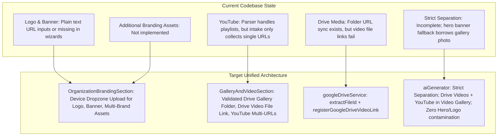

# DIGIVERSE — UNIVERSAL ORGANIZATION BRANDING, GOOGLE DRIVE MEDIA & YOUTUBE CONTENT INTEGRATION MASTER PLAN

> **For agentic workers:** REQUIRED SUB-SKILL: Use `superpowers:subagent-driven-development` (recommended) or `superpowers:executing-plans` to implement this plan task-by-task. Steps use checkbox (`- [ ]`) syntax for tracking.

**Goal:** Implement a complete, production-ready Organization Branding and Media Collection System across the entire DigiVerse SaaS platform covering all four Website Creation Engines (Sports, Cultural, Event, and Social & NGO), strictly separating Group A (Official Branding: Logo, Hero Banner, Supporting Brand Images) from Group B (Website Gallery & Video: Google Drive Photo Folder, Google Drive Video Link, YouTube Video/Playlist Links), persisting assets in SQLite, and properly consuming them in generated websites.

**Architecture:**
- **Group A (Organization Branding Assets):** High-resolution local device upload for Official Organization Logo, Homepage Hero Banner / Cover Image, and Additional Branding Images. Validated on backend, stored in `server/data/uploads`, served securely via `/api/media/uploads/:filename`, and mapped directly to Navbar, Header, Hero, and Footer components.
- **Group B (Gallery & Video Content):** Validated Google Drive Media / Gallery Folder Link (synchronized to `drive_media_items` for photo galleries), Google Drive Video Link (file URL parsed to extract `fileId`, registered as video asset, streamed/previewed securely), and YouTube Video / Playlist Links (parsed, thumbnail cached, embed URL generated).
- **Strict Separation Policy:** Group A is never mixed with Group B. Gallery photos are never used as logos or hero banners. Drive/YouTube videos are never used as logos.
- **Universal Multi-Step Form Integration:** Standardized, reusable `<OrganizationBrandingSection />` and `<GalleryAndVideoSection />` components integrated across all five requirement wizards (`SportsRequirementWizard`, `CulturalRequirementWizard`, `EventRequirementWizard`, `NGORequirementWizard`, `RequirementCollectionWizard`) preserving 100% of existing fields.
- **Website Generation Engine Consumption:** `synthesizeWebsite` in `aiGenerator.ts` consumes official branding for identity and layout cover, and routes gallery photos and video streams to dedicated gallery/video sections across all four engines.

**Tech Stack:** React 18, TypeScript, Tailwind CSS, Lucide icons, Node.js, Express, SQLite (`node:sqlite` in WAL mode), Google Drive v3 integration, YouTube embed parser.

---

## Global Constraints

1. **All Four Engines Covered:** Sports, Cultural, Event, and Social & NGO must all receive the complete branding and media integration.
2. **Preserve All Existing Fields:** Zero fields, steps, validations, categories, or archetypes may be removed, renamed, or broken.
3. **Strict Separation of Group A and Group B:** Organization Branding (Logo, Hero Banner, Brand Images) and Gallery/Video Content (Drive Gallery, Drive Video, YouTube) must remain strictly segregated in the UI, database, and generation pipeline.
4. **Dedicated Logo & Hero Banner Uploads:** Official Logo and Hero Banner must have dedicated device upload dropzones with preview, replace, and remove capabilities.
5. **Secure Drive Handling:** No private credentials, access tokens, or raw file IDs exposed in public HTML. Drive Video Links must support single-file URLs.
6. **No Git / No OCI / No Deploy:** No Git commands (`git init`, `add`, `commit`), no OCI/cloud provisioning, no billable resource creation.
7. **Two-Stage Execution:** Complete read-only audit first; wait for user authorization (`PROCEED`) before modifying files.

---

## Review Focus

1. **Attempting to upload oversized or unsupported logo formats:** Uploading a non-image file (e.g. `.exe`, `.pdf`) or file exceeding 10MB returns `400 Bad Request` with an informative error message.
2. **Drive Folder vs. Drive Video File link parsing:** Pasting a Google Drive file link (`https://drive.google.com/file/d/{fileId}/view`) into the Drive Video Link field correctly extracts the `fileId` and registers it as a video asset, distinct from folder URLs (`/folders/{folderId}`).
3. **Empty or partial optional branding:** Submitting a wizard with no logo, no hero banner, or no video links succeeds gracefully; generation engine falls back to archetype default colors/stock without runtime exceptions.
4. **YouTube playlist detection:** Pasting a YouTube playlist URL (`https://www.youtube.com/playlist?list=...` or `watch?v=...&list=...`) generates a `videoseries?list=` embed URL and marks the item with a playlist tag.
5. **Group A vs Group B cross-contamination prevention:** Verifying that Google Drive gallery photographs are NEVER placed in the navbar logo slot or hero banner slot, and uploaded logos are NEVER injected into the photo gallery grid.

---

# PART 1 — COMPLETE ARCHITECTURE AUDIT & MATRIX

### 1. Engine and Category Coverage Matrix

| Engine | Website Type / Archetype | Requirement Wizard | Existing Branding State | Existing Media State | Integration Target |
|---|---|---|---|---|---|
| **Sports** | Sports Club | `SportsRequirementWizard.tsx` (15 steps) | Step 2: Plain text URL for club crest only | Step 10: YouTube URL input only | Step 2: Full Group A; Step 10: Full Group B |
| **Sports** | Tournament Hub | `SportsRequirementWizard.tsx` (15 steps) | Step 2: Plain text URL for tournament logo | Step 10: YouTube URL input only | Step 2: Full Group A; Step 10: Full Group B |
| **Sports** | Sports Academy | `SportsRequirementWizard.tsx` (15 steps) | Step 2: Plain text URL for academy crest | Step 10: YouTube URL input only | Step 2: Full Group A; Step 10: Full Group B |
| **Cultural** | Cultural Society & Association | `CulturalRequirementWizard.tsx` (15 steps) | Step 2: Plain text URLs for logo and cover | Step 11: Static preset cards, no input | Step 2: Full Group A; Step 11: Full Group B |
| **Cultural** | Puja Committee | `CulturalRequirementWizard.tsx` (15 steps) | Step 2: Plain text URLs for emblem and banner | Step 11: Static preset cards, no input | Step 2: Full Group A; Step 11: Full Group B |
| **Event** | Conference & Seminar | `EventRequirementWizard.tsx` (15 steps) | Step 12: Colors and typography only | Step 11: Drive folder URLs, 1 YouTube text | Step 12: Full Group A; Step 11: Full Group B |
| **Event** | Festival & Concert | `EventRequirementWizard.tsx` (15 steps) | Step 12: Colors and typography only | Step 11: Drive folder URLs, 1 YouTube text | Step 12: Full Group A; Step 11: Full Group B |
| **Event** | Corporate & Business | `EventRequirementWizard.tsx` (15 steps) | Step 12: Colors and typography only | Step 11: Drive folder URLs, 1 YouTube text | Step 12: Full Group A; Step 11: Full Group B |
| **Event** | Exhibition & Trade Fair | `EventRequirementWizard.tsx` (15 steps) | Step 12: Colors and typography only | Step 11: Drive folder URLs, 1 YouTube text | Step 12: Full Group A; Step 11: Full Group B |
| **Event** | Wedding & Private Events | `EventRequirementWizard.tsx` (15 steps) | Step 12: Colors and typography only | Step 11: Drive folder URLs, 1 YouTube text | Step 12: Full Group A; Step 11: Full Group B |
| **Event** | Award Ceremony & Gala | `EventRequirementWizard.tsx` (15 steps) | Step 12: Colors and typography only | Step 11: Drive folder URLs, 1 YouTube text | Step 12: Full Group A; Step 11: Full Group B |
| **Event** | Product / Brand Launch | `EventRequirementWizard.tsx` (15 steps) | Step 12: Colors and typography only | Step 11: Drive folder URLs, 1 YouTube text | Step 12: Full Group A; Step 11: Full Group B |
| **Social & NGO** | Grassroots NGO | `NGORequirementWizard.tsx` (15 steps) | Step 4: Colors and typography only | Step 15: 4 drive folder path strings | Step 4: Full Group A; Step 15: Full Group B |
| **Social & NGO** | Institutional Foundation | `NGORequirementWizard.tsx` (15 steps) | Step 4: Colors and typography only | Step 15: 4 drive folder path strings | Step 4: Full Group A; Step 15: Full Group B |
| **Social & NGO** | Cause Charity | `NGORequirementWizard.tsx` (15 steps) | Step 4: Colors and typography only | Step 15: 4 drive folder path strings | Step 4: Full Group A; Step 15: Full Group B |
| **Generic** | Custom / Other Orgs | `RequirementCollectionWizard.tsx` (6 steps) | Step 2: Plain text URL for logo | Step 5: Plain text inputs for Drive and YouTube | Step 2: Full Group A; Step 5: Full Group B |

---

### 2. Gap Analysis Summary



1. **Frontend Intake Gap:** Currently, none of the 5 wizards have a real local device upload dropzone for Logo or Hero Banner. Clients had to host images elsewhere and paste URLs. Additional Branding Images were completely unsupported.
2. **Google Drive Video File Link Gap:** `googleDriveService.ts` only extracts folder IDs (`/folders/{id}`). When a client submits a direct video link (`https://drive.google.com/file/d/{id}/view`), it fails regex validation.
3. **Database Column Gap:** `project_requirements` table only holds `logo_url` and `cover_image_url`. It lacks dedicated columns for `additional_branding_images_json`, `drive_gallery_url`, and `drive_video_url`.
4. **Website Generation Gap:** `aiGenerator.ts` currently falls back to `assignedHero || firstApprovedImage` from Drive gallery items if `coverImageUrl` is empty. This violates Section 5 ("Never automatically use a Google Drive Gallery Folder as the Organization Logo or Hero Banner source").

---

# PART 2 — TECHNICAL DESIGN & COMPONENT SPECIFICATION

### 1. Data Model & Type Enhancements

#### In `server/src/types/index.ts` and `client/src/types/admin.ts`:
```ts
export interface ClientRequirements {
  // Existing fields preserved...
  logoUrl?: string;
  coverImageUrl?: string;
  
  // NEW: Additional Supporting Branding Images
  additionalBrandingImages?: string[];

  // NEW & Canonical: Explicit Gallery & Video URLs
  googleDriveGalleryUrl?: string; // Canonical Drive Gallery Folder Link
  googleDriveVideoUrl?: string;   // Canonical Drive Video Link (file link)
  googleDriveVideoUrls?: string[]; // Multiple video file links if provided

  // Existing Drive folder object (retained for backward compatibility)
  googleDriveUrl?: string;
  googleDriveMediaFolders?: GoogleDriveMediaFolders;

  // YouTube Links (single videos and playlists)
  youtubeUrls?: string[];
  youtubePlaylistUrls?: string[];

  // Existing engine-specific objects preserved...
  sportsData?: SportsWebsiteData;
  culturalData?: CulturalWebsiteData;
  eventData?: EventWebsiteData;
  ngoData?: NGOWebsiteData;
}
```

```ts
export interface VideoItem {
  id: string;
  videoId: string;
  originalUrl: string;
  embedUrl: string;
  title: string;
  category: string;
  provider?: 'youtube' | 'google_drive';
  videoType?: 'video' | 'playlist' | 'shorts';
  thumbnailUrl?: string;
}
```

---

### 2. Database Schema Migrations

#### In `server/src/db/database.ts`:
```sql
-- Ensure project_requirements table has dedicated columns
ALTER TABLE project_requirements ADD COLUMN additional_branding_images_json TEXT;
ALTER TABLE project_requirements ADD COLUMN drive_gallery_url TEXT;
ALTER TABLE project_requirements ADD COLUMN drive_video_url TEXT;
ALTER TABLE project_requirements ADD COLUMN youtube_urls_json TEXT;

-- Enhance drive_media_items with optional source_url
ALTER TABLE drive_media_items ADD COLUMN source_url TEXT;
```

---

### 3. Backend Services & API Endpoints

#### A. Secure Upload Service Enhancements (`server/src/routes/media.ts`)
- Enhance `POST /api/media/upload`:
  - Validate MIME types: `image/png`, `image/jpeg`, `image/jpg`, `image/webp`, `image/svg+xml`, `image/gif`.
  - Validate file size: maximum 10MB for `logo` and `hero_banner`, 15MB for `branding`.
  - Accept `assetType`: `'logo' | 'hero_banner' | 'branding' | 'general'`.
  - Return `{ success: true, url: string, filename: string, sizeBytes: number, mimeType: string, assetType: string }`.

#### B. Google Drive Video Link Handler (`server/src/services/googleDriveService.ts`)
- Add `extractFileId(input: string): string | null`:
  - Match `/\/file\/d\/([a-zA-Z0-9_-]+)/`
  - Match `/[?&]id=([a-zA-Z0-9_-]+)/`
  - Match `/open\?id=([a-zA-Z0-9_-]+)/`
  - Match `/uc\?id=([a-zA-Z0-9_-]+)/`
- Add `registerGoogleDriveVideoLink(projectId: string, videoUrl: string, orgType?: string): DriveMediaItem | null`:
  - Extracts file ID.
  - Constructs embed preview URL: `https://drive.google.com/file/d/${fileId}/preview`.
  - Saves to `drive_media_items` table with `mediaType: 'video'` and `sectionAssignment: 'video'`.

#### C. YouTube Playlist & Multi-Video Integration (`server/src/services/youtubeService.ts`)
- Enhance `parseYouTubeUrl` to flag `videoType: 'playlist'` when `list=` query parameter is present.
- Support both individual videos and full playlists with embed URLs (`https://www.youtube-nocookie.com/embed/videoseries?list=${playlistId}`).

#### D. Project Creation Intake Route (`server/src/routes/projects.ts`)
- In `POST /api/projects`:
  - Persist `logoUrl`, `coverImageUrl`, `additionalBrandingImages`.
  - If `googleDriveGalleryUrl` is provided, sync folder images to `drive_media_items` with `mediaType: 'image'`.
  - If `googleDriveVideoUrl` is provided, parse and register video item to `drive_media_items` with `mediaType: 'video'`.
  - If `youtubeUrls` are provided, register each in `youtube_videos`.

---

### 4. Reusable Frontend Components

#### Component 1: `OrganizationBrandingSection.tsx`
Location: `client/src/components/admin/media/OrganizationBrandingSection.tsx`
- **Group A Container with Distinct Visual Identity** (Indigo/Cyan accents).
- **Official Organization Logo Card:**
  - Drag-and-drop file upload + "Browse File" button.
  - Formats: PNG, JPG, JPEG, SVG, WebP (max 10MB).
  - Instant image preview card with dimension & size telemetry.
  - "Replace Logo" and "Remove Logo" buttons.
  - Upload progress / loading spinner.
- **Website Hero Banner / Cover Image Card:**
  - Drag-and-drop file upload + "Browse File" button.
  - 16:9 banner preview with aspect ratio guideline.
  - "Replace Banner" and "Remove Banner" controls.
- **Additional Branding Images:**
  - Multi-file dropzone.
  - Horizontal thumbnail carousel of uploaded brand assets with 1-click delete.
  - Upload counter: `X assets uploaded`.

#### Component 2: `GalleryAndVideoSection.tsx`
Location: `client/src/components/admin/media/GalleryAndVideoSection.tsx`
- **Group B Container with Distinct Visual Identity** (Emerald/Amber accents).
- **Strict Separation Callout Banner:**
  *"Website Gallery & Video Content — All assets in this section will populate your website's photo gallery, event media archive, and video showcase sections. They are strictly isolated from your official organization branding."*
- **Google Drive Media / Gallery Folder Link:**
  - URL input with Google Drive icon.
  - Inline validation detecting `/folders/{id}`.
  - Real-time accessibility verification indicator.
- **Google Drive Video Link:**
  - URL input with Video icon.
  - Inline validation detecting `/file/d/{id}` or `?id={id}`.
  - Formats supported: MP4, WebM, QuickTime (MOV).
- **YouTube Video / Playlist Link:**
  - Dynamic multi-link list with "Add Video Link" input.
  - Detects standard watch URLs, short URLs, and playlists (`list=...`).
  - Thumbnail preview card for each added YouTube link.
  - Playlist badge indicator (`[ PLAYLIST ]`).
  - Delete action per video link.

---

### 5. Website Generation Engine Synthesis (`aiGenerator.ts`)

- In `synthesizeWebsite`:
  1. **Strict Group A Consumption:**
     - `navigationBar.logoUrl = reqs.logoUrl || ...`
     - `heroImage = reqs.coverImageUrl || archetypeStockBanner;`
     - **NEVER** overwrite `heroImage` with an arbitrary Drive gallery photo.
     - `website.additionalBrandingImages = reqs.additionalBrandingImages || [];`
  2. **Strict Group B Consumption:**
     - `galleryPhotos`: Mapped strictly from `driveItems` where `mediaType === 'image'`.
     - `featuredVideos`: Mapped from:
       - YouTube videos (`youtubeVideos` list)
       - Google Drive video items (`driveItems` where `mediaType === 'video'`) with `provider: 'google_drive'` and `embedUrl: 'https://drive.google.com/file/d/${item.driveFileId}/preview'`.
  3. **Section Availability Across All 4 Engines:**
     - Sports: Feeds `sports_gallery` and match video highlights.
     - Cultural: Feeds `cultural_gallery`, `puja_gallery`, and cultural video performances.
     - Event: Feeds `event_gallery` and event video recordings.
     - Social & NGO: Feeds `ngo_gallery` and documentary/campaign videos.

---

# PART 3 — TASK DECOMPOSITION & STEP-BY-STEP PLAN

### Task 1: Type Definitions, Database Migrations & Upload Validation
**Files:**
- Modify: `server/src/types/index.ts`
- Modify: `client/src/types/admin.ts`
- Modify: `server/src/db/database.ts`
- Modify: `server/src/routes/media.ts`

- [ ] **Step 1: Update type definitions in `server/src/types/index.ts` and `client/src/types/admin.ts`**
  - Add `additionalBrandingImages?: string[]` to `ClientRequirements`.
  - Add `googleDriveGalleryUrl?: string` and `googleDriveVideoUrl?: string` to `ClientRequirements`.
  - Add `provider?: 'youtube' | 'google_drive'` and `videoType?: 'video' | 'playlist' | 'shorts'` to `VideoItem` and `YouTubeVideo`.
  - Add `additionalBrandingImages?: string[]` to `GeneratedWebsite`.
- [ ] **Step 2: Update database schema in `server/src/db/database.ts`**
  - Add migration altering `project_requirements` to add `additional_branding_images_json`, `drive_gallery_url`, and `drive_video_url`.
- [ ] **Step 3: Enhance upload endpoint in `server/src/routes/media.ts`**
  - Enforce MIME types: `image/png`, `image/jpeg`, `image/jpg`, `image/webp`, `image/svg+xml`, `image/gif`.
  - Enforce max size limits (10MB for logo/hero, 15MB for branding).
  - Return metadata with `assetType`.
- [ ] **Step 4: Verify server compilation**
  Run: `cmd /c "npm --prefix server run build"`

---

### Task 2: Google Drive Video & YouTube Playlist Service Upgrades
**Files:**
- Modify: `server/src/services/googleDriveService.ts`
- Modify: `server/src/services/youtubeService.ts`
- Modify: `server/src/routes/media.ts`

- [ ] **Step 1: Implement `extractFileId` and `registerGoogleDriveVideoLink` in `googleDriveService.ts`**
  - Parse Google Drive single-file URLs (`/file/d/{id}`, `?id={id}`, `/open?id=`, `/uc?id=`).
  - Create `registerGoogleDriveVideoLink(projectId, videoUrl, orgType)`.
- [ ] **Step 2: Enhance `parseYouTubeUrl` in `youtubeService.ts`**
  - Ensure playlists are parsed with `type: 'playlist'` and `videoseries?list=` embed URLs.
- [ ] **Step 3: Add Drive Video connect endpoint in `server/src/routes/media.ts`**
  - `POST /api/media/drive/video` to validate and register a direct Google Drive video link.
- [ ] **Step 4: Verify server compilation**
  Run: `cmd /c "npm --prefix server run build"`

---

### Task 3: Project Intake Route & Website Generation Integration
**Files:**
- Modify: `server/src/routes/projects.ts`
- Modify: `server/src/services/aiGenerator.ts`

- [ ] **Step 1: Update `POST /api/projects` in `server/src/routes/projects.ts`**
  - Ingest `additionalBrandingImages`.
  - Handle `googleDriveGalleryUrl` for photo gallery syncing.
  - Handle `googleDriveVideoUrl` using `registerGoogleDriveVideoLink`.
  - Ingest all `youtubeUrls` with playlist support.
- [ ] **Step 2: Update `synthesizeWebsite` in `server/src/services/aiGenerator.ts`**
  - Strict separation: Logo uses `reqs.logoUrl`, Hero Banner uses `reqs.coverImageUrl`.
  - Never auto-assign gallery photo as logo or hero banner.
  - Ingest Google Drive videos alongside YouTube videos into `featuredVideos`.
  - Expose `additionalBrandingImages` on `generatedWebsite`.
- [ ] **Step 3: Verify server compilation**
  Run: `cmd /c "npm --prefix server run build"`

---

### Task 4: Reusable Frontend Branding & Media Components
**Files:**
- Create: `client/src/components/admin/media/OrganizationBrandingSection.tsx`
- Create: `client/src/components/admin/media/GalleryAndVideoSection.tsx`
- Modify: `client/src/lib/api.ts`

- [ ] **Step 1: Add API client methods in `client/src/lib/api.ts`**
  - `uploadAsset(fileData, filename, assetType)` helper.
  - `connectDriveVideo(projectId, videoUrl)` helper.
- [ ] **Step 2: Build `OrganizationBrandingSection.tsx`**
  - Official Organization Logo dropzone with preview, replace, remove.
  - Website Hero Banner / Cover Image dropzone with 16:9 preview.
  - Additional Organization Branding Assets multi-upload dropzone.
- [ ] **Step 3: Build `GalleryAndVideoSection.tsx`**
  - Strict separation warning banner.
  - Google Drive Media / Gallery Folder Link input with validation.
  - Google Drive Video Link input with validation.
  - YouTube Video / Playlist Link multi-entry list with previews and playlist badge.
- [ ] **Step 4: Verify client compilation**
  Run: `cmd /c "npm --prefix client run build"`

---

### Task 5: Integration Across All Four Engine Wizards
**Files:**
- Modify: `client/src/components/admin/SportsRequirementWizard.tsx`
- Modify: `client/src/components/admin/CulturalRequirementWizard.tsx`
- Modify: `client/src/components/admin/EventRequirementWizard.tsx`
- Modify: `client/src/components/admin/NGORequirementWizard.tsx`
- Modify: `client/src/components/admin/RequirementCollectionWizard.tsx`

- [ ] **Step 1: Integrate into `SportsRequirementWizard.tsx`**
  - Step 2: Embed `OrganizationBrandingSection`.
  - Step 10: Embed `GalleryAndVideoSection`.
  - Preserve all 15 sports-specific steps and fields.
- [ ] **Step 2: Integrate into `CulturalRequirementWizard.tsx`**
  - Step 2: Embed `OrganizationBrandingSection`.
  - Step 11: Embed `GalleryAndVideoSection`.
  - Preserve all cultural & puja committee fields.
- [ ] **Step 3: Integrate into `EventRequirementWizard.tsx`**
  - Step 12: Embed `OrganizationBrandingSection`.
  - Step 11: Embed `GalleryAndVideoSection`.
  - Preserve all 7 event category fields.
- [ ] **Step 4: Integrate into `NGORequirementWizard.tsx`**
  - Step 4: Embed `OrganizationBrandingSection`.
  - Step 15: Embed `GalleryAndVideoSection`.
  - Preserve all 3 NGO archetype fields.
- [ ] **Step 5: Integrate into `RequirementCollectionWizard.tsx`**
  - Step 2: Embed `OrganizationBrandingSection`.
  - Step 5: Embed `GalleryAndVideoSection`.
- [ ] **Step 6: Build client and verify 0 compilation errors**
  Run: `cmd /c "npm --prefix client run build"`

---

### Task 6: Automated Testing & End-to-End Verification
**Files:**
- Create: `server/test/brandingMediaIntegration.test.ts`
- Create: `<Artifact Directory>/branding_media_final_delivery_report.md`

- [ ] **Step 1: Write integration tests in `server/test/brandingMediaIntegration.test.ts` covering:**
  1. Organization Logo upload with valid PNG/SVG.
  2. Organization Hero Banner upload with dimension and size validation.
  3. Additional Branding Images upload and retrieval.
  4. Google Drive Gallery Folder URL validation and image discovery.
  5. Google Drive Video Link (`/file/d/{id}`) validation and video asset registration.
  6. YouTube Video URL parsing and metadata extraction.
  7. YouTube Playlist URL (`list=...`) parsing and playlist embed extraction.
  8. Strict separation verification: Logo and Hero Banner never in gallery; gallery photos never as logo/hero.
  9. Website generation with all asset groups populated across Sports, Cultural, Event, and NGO.
  10. Graceful fallback when optional branding or media is omitted.
  11. Regression check: Existing Super Admin and Admin authentication tests remain 100% green.
- [ ] **Step 2: Run test suite**
  Run: `cmd /c "cd server && npx tsx --test test/brandingMediaIntegration.test.ts"`
- [ ] **Step 3: Run full regression test suite**
  Run: `cmd /c "cd server && npx tsx --test test/superAdminGovernance.test.ts"`
  Run: `cmd /c "cd server && npx tsx --test test/adminAuthGovernance.test.ts"`
- [ ] **Step 4: Produce final delivery report and walkthrough**

---

## Verification Plan

### Automated Tests
1. `cmd /c "cd server && npx tsx --test test/brandingMediaIntegration.test.ts"`
2. `cmd /c "cd server && npx tsx --test test/superAdminGovernance.test.ts"`
3. `cmd /c "cd server && npx tsx --test test/adminAuthGovernance.test.ts"`
4. `cmd /c "npm --prefix server run build"`
5. `cmd /c "npm --prefix client run build"`

### Manual Verification
1. Open Staff Portal -> Start New Client Website for each of the 4 engines (Sports, Cultural, Event, NGO).
2. Upload an official PNG logo and verify preview, replace, and remove.
3. Upload a 16:9 hero banner and verify aspect ratio preview.
4. Upload 2 additional branding images.
5. Provide a Google Drive Gallery Folder Link.
6. Provide a Google Drive Video Link.
7. Provide a YouTube video and a YouTube playlist link.
8. Click "Generate Website" -> Inspect generated website in Studio.
9. Verify that Navbar contains the uploaded Logo, Hero Section contains the uploaded Hero Banner, Photo Gallery contains the Drive photos, and Video Showcase contains the Drive video and YouTube playlist.
10. Verify zero cross-contamination between branding and gallery assets.
